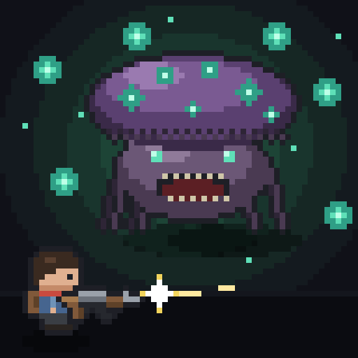
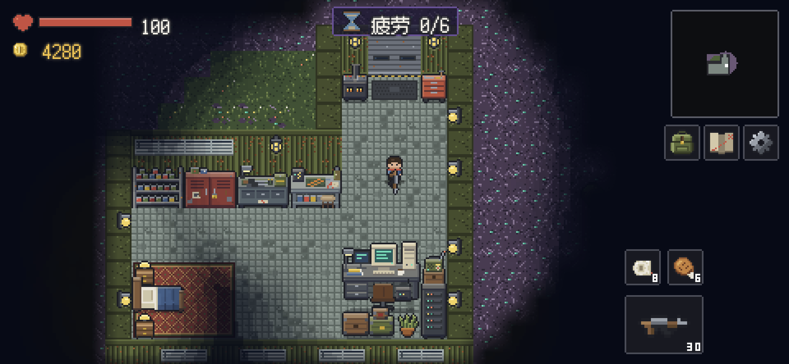
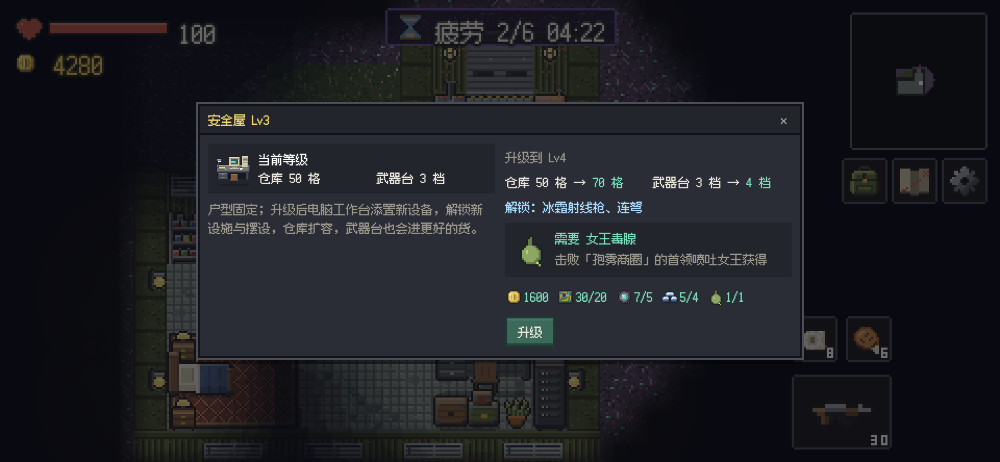
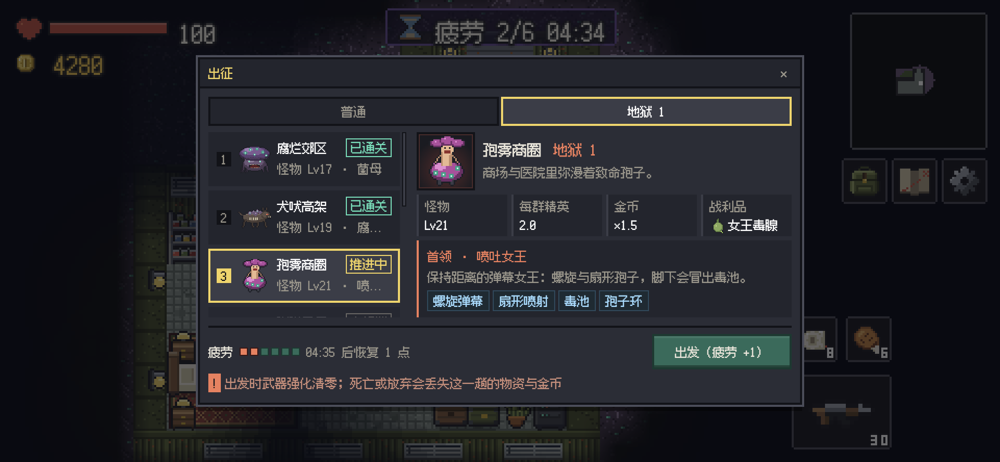
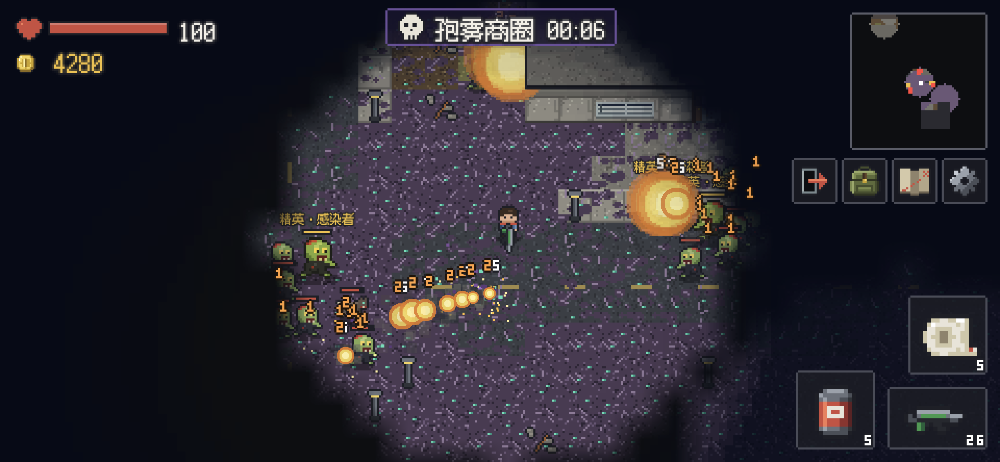
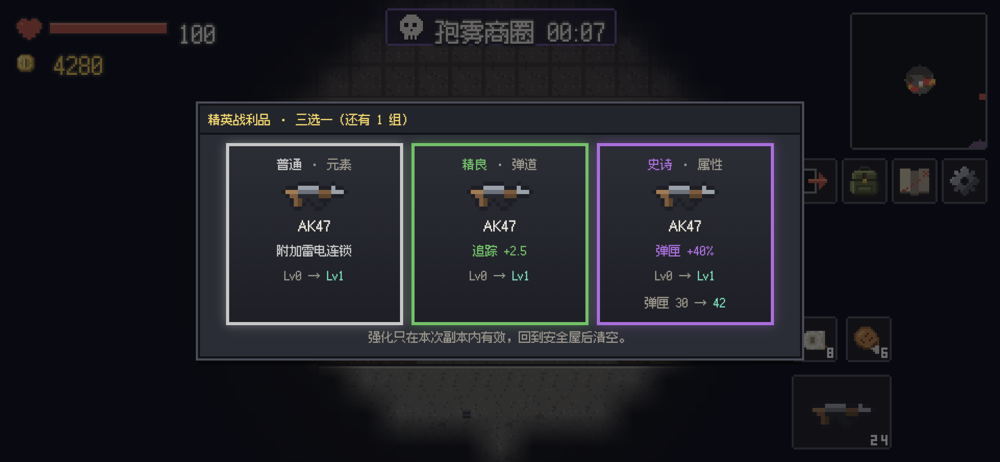
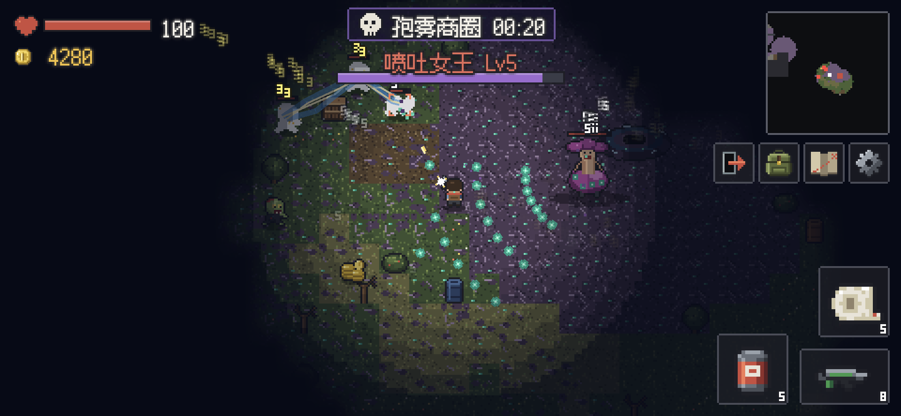

<h1 align="center">菌群世界</h1>

末日菌群下的像素风生存射击小游戏：从安全屋出征，清剿菌群、击败首领、带回物资升级安全屋。

  <a href="https://chichichiyuyu.github.io/fungal-world/"><b>▶ 手机 / 浏览器直接玩</b></a>

## 玩法介绍

### 安全屋：经营你的据点

  
  

- 安全屋是出征的起点，也是唯一安全的地方。
- **储物柜**：共享仓库，物资和武器都放这里。
- **武器台**：购买武器与补给，共 16 把枪，从手枪、霰弹枪到激光枪、火箭筒。
- **工作台**：制作绷带和医疗包。
- **烹饪架**：烹饪食物。
- 用金币、材料和首领战利品升级安全屋，最高 8 级。每升一级，仓库扩容、武器台进更好的货，屋里也会添置新设施和摆设。

### 出征：8 个副本，层层深入

  
  

- 走到安全屋北边的卷闸门选择副本出征。副本依次解锁：

  腐烂郊区 → 犬吠高架 → 孢雾商圈 → 膨胀工厂 → 甲壳荒原 → 菌丝密林 → 双生医院 → 菌群核心

- 8 个副本全部打通后开启 **地狱难度**。每深入一层，怪物等级更高、精英更多、金币也更多。
- 副本里的建筑可以搜刮：箱子、柜子、冰箱、枪柜里都有物资。搜刮时要原地停留片刻，移动会打断。
- 每次出征消耗 1 点疲劳，上限 6 点，每 5 分钟恢复 1 点。
- 死亡或中途放弃，会丢掉这一趟捡到的物资和金币。

### 强化卡与首领：每一局都不一样

  
  

- 靠近敌人会自动瞄准射击。地面亮起红色预警时，尽快离开。
- 击杀精英获得 **强化卡三选一**，有元素（雷电连锁、灼烧、冰冻、中毒、爆破）、弹道（穿透、弹射、追踪）、属性、角色几类。强化只在本次副本内有效，出发时武器强化清零，每一局都能凑出不同的流派。
- 每个副本深处都有首领培养皿（地图上的红点），靠近后唤醒首领。8 个首领各有招式：冲撞、扑咬、螺旋弹幕、跃击分裂、冲锋眩晕、瞬移、双子狂暴……最终的菌群之心会轮流使用所有首领的招式。
- 击败首领后奖励立即入账，几秒后自动回程。首领战利品是升级安全屋的关键，之后的升级用不到时就不会再掉落。

## 操作

| 平台 | 操作 |
| --- | --- |
| 手机 | 按住屏幕任意空白处出现摇杆，拖动移动，左右手都能用；快捷物品（默认绷带和罐头）、交互、换弹按钮都在右下角，右手拇指就能点到 |
| 电脑 | WASD 移动，E 交互，R 换弹，1 / 2 使用快捷物品，B 背包，M 地图 |

在手机浏览器里选择"添加到主屏幕"，就能像 App 一样全屏玩。

存档保存在当前浏览器里，换浏览器或清除网站数据会丢失。

---

源代码不公开。未经许可请勿转载、二次分发或商用，保留所有权利。
